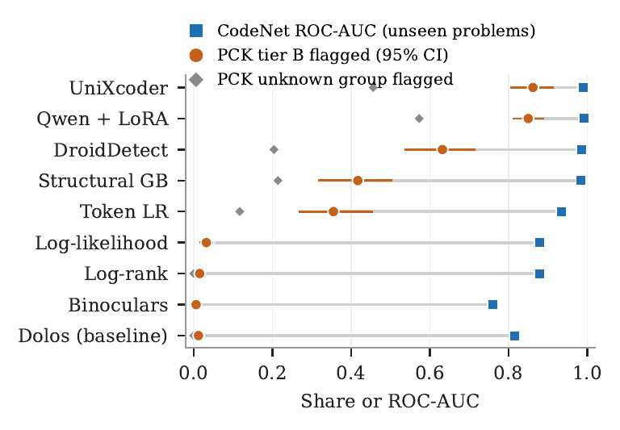
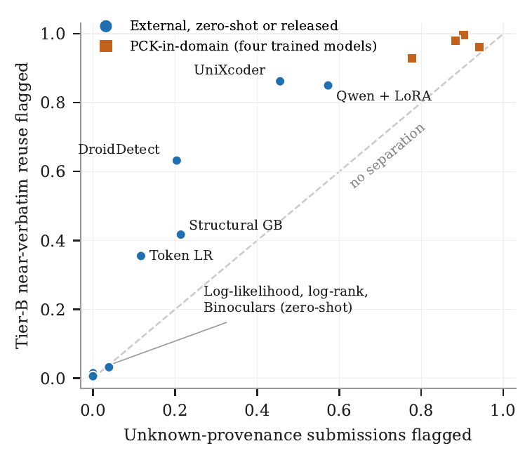
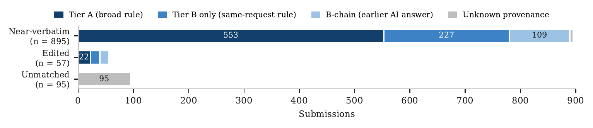
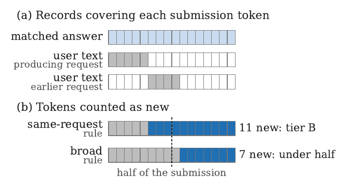
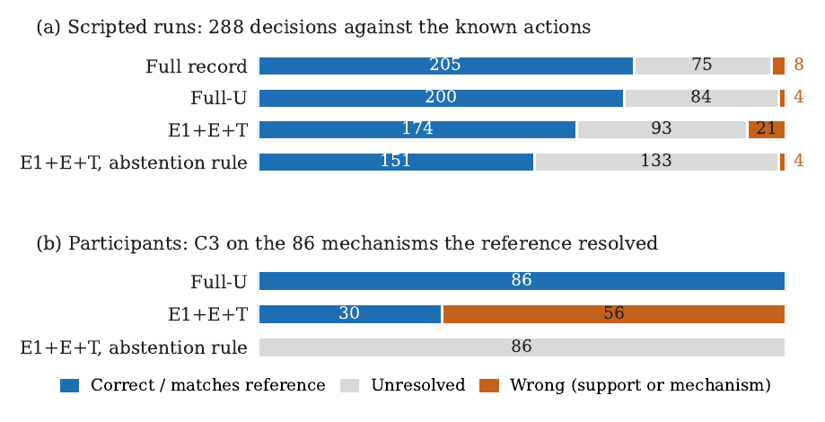
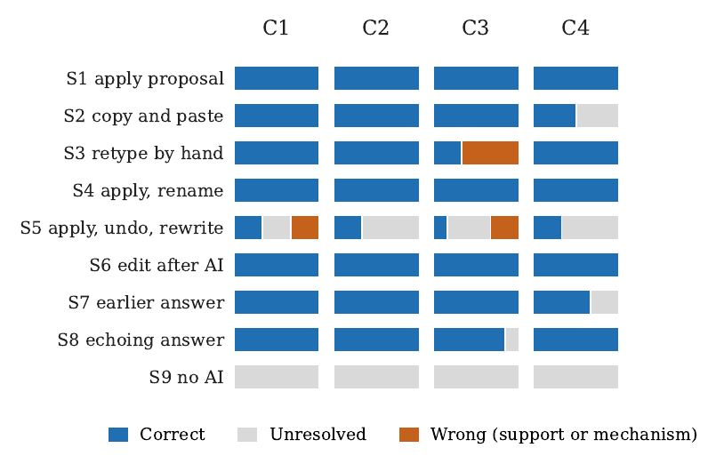
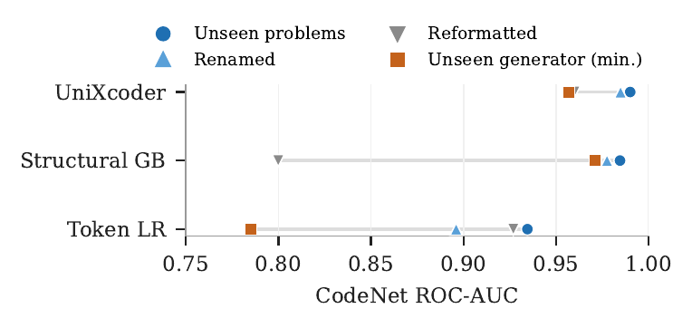
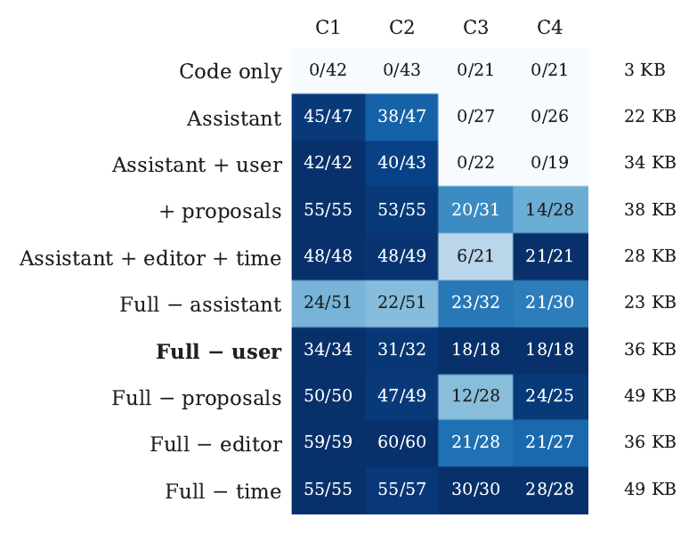

# What code detectors and interaction records can establish about AI-code reuse in programming education

Analysis code, aggregate results and figures for the manuscript *Beyond Code-Only Detection* (University of Aizu, Japan).

The study uses one four-hour AI-permitted programming session (21 participants, 1,047 judged submissions) whose
environment recorded assistant answers, prompts, edit proposals, editor events and timestamps. It asks which claims
about a learner's reuse of AI code each combination of records supports, checks the records against scripted runs with known
actions, and evaluates code-only AI detectors on recorded reuse.

> **No source code, prompts, assistant answers or timestamps from the session are included.** The session's data
> appear only as pseudonymised, code-free tables in `data/` (new random submission, participant and case IDs). These
> tables are enough to recompute every detector rate, every record-configuration table and the trace validation; see
> [Reproducing the results](#reproducing-the-results).

## Repository layout

| Path | Contents |
|---|---|
| `code/analysis/` | Reference labels (`tlt_pck_labels.py`, `tlt_echo_*.py`), record configurations and scoring (`tlt_rq4_*.py`, `tlt_c3_abstain_score.py`, `tlt_third_check.py`), detectors (`tlt_detect*.py`, `tlt_dolos.py`, `tlt_generate.py`), learning analytics and sensitivity (`tlt_la_*.py`, `tlt_sensitivity.py`), trace scoring (`tlt_trace_score.py`), figures (`tlt_figures.py`) |
| `code/trace_driver/` | Scripted driver for the controlled trace runs on a local copy of the environment (Playwright), packet builders, local model shim |
| `data/` | Pseudonymised, code-free tables (see [Data](#data)) |
| `reproduce/` | Five short scripts that recompute the paper's results from `data/` and check them against `results/` |
| `results/` | Aggregate JSON outputs |
| `figures/` | The manuscript figures as SVG and PNG |

## Main results at a glance

**Records.** With prompts withheld but assistant output, proposals, editor events and timestamps kept, reviewers
reproduced 101 of 102 resolved full-record decisions in the randomized cases and 485 of 490 over all 177 cases
(`results/rq4_main.json`). Without proposal records the insertion mechanism could not be resolved
(`results/c3_abstain.json`).

**Controlled traces.** Across 42 scripted runs the submitted program was always recovered from the records. Retyping at
2.7–6.7 characters per second was identified as incremental arrival; fast scripted retyping (about 13.6 characters per
second) was read as an insertion in two of three runs (`results/trace_validation.json`).

**Detectors** (`results/detection.json`; threshold fixed at 5% of CodeNet validation human code):

| Method | CodeNet ROC-AUC (unseen problems) | PCK tier-B near-verbatim flagged (n = 780) | PCK unknown group flagged (n = 103) |
|---|---|---|---|
| Token LR | 0.93 | 36% | 12% |
| Structural GB | 0.98 | 42% | 21% |
| Log-likelihood (zero-shot) | 0.88 | 3% | 4% |
| Log-rank (zero-shot) | 0.88 | 2% | 0% |
| Binoculars (zero-shot) | 0.76 | 1% | 0% |
| DroidDetect (as released) | 0.99 | 63% | 20% |
| UniXcoder (fine-tuned) | 0.99 | 86% | 46% |
| Qwen2.5-Coder + LoRA (fine-tuned) | 0.99 | 85% | 57% |
| Dolos similarity (baseline) | 0.82 | 1% | 0% |

The unknown group is submissions whose provenance the records leave open; it is not a human control, so its flag rate
is not a false-positive rate.

**Learning analytics** (`results/la_demo.json`, `results/la_extended.json`). Labelled by the records, submissions that
reused AI code were accepted less often (20% against 45%; odds ratio within problem 0.25), and learners who reused more
were accepted less often (Spearman rho = -0.61 over 21 learners). Labelled by detector flags, the gap shrank to 6-10
points and the learner-level association weakened. Detection of recorded reuse also fell for answers from higher model
stages, within each length tercile.

## Figures

**The transfer gap.** CodeNet ROC-AUC against the share of recorded PCK reuse and of the unknown group flagged.



**Operating points on PCK.** Share of tier-B reuse flagged against share of the unknown group flagged.



**Reference groups.** How the 1,047 submissions divide into reference groups.



**Echo rules.** The two rules for discounting the learner's own code, on a constructed example.



**Reduced records.** (a) Scripted runs scored against known actions; (b) insertion mechanisms in participant submissions.



**Trace reconstruction.** Scenarios S1–S9, both adjudicators pooled.



**Robustness within CodeNet.** ROC-AUC of the trainable detectors under four conditions.



**Record configurations.** Agreement with the full-record reference per configuration and claim.



## Reproducing the results

```bash
pip install numpy scipy scikit-learn matplotlib
python reproduce/detection.py   # Table VIII, length terciles, new-token bands, deduplicated units
python reproduce/records.py     # Tables VI and VII: agreement A_c and coverage C_c per configuration
python reproduce/traces.py      # controlled trace validation (42 scripted runs and reduced packets)
python reproduce/learning_analytics.py  # Table X: record vs detector labels in one learning-analytics question
python reproduce/figures.py     # redraws the figures from results/
```

The first four scripts print their tables and compare them with the corresponding files in `results/`; all match. `figures.py` writes the figures to `reproduced/figures/`. The
detection intervals use a participant-clustered bootstrap (2,000 resamples), so they can differ from the paper in the
third decimal.

## Data

| File | One row per | Columns |
|---|---|---|
| `data/items.csv` | program | `item_id`, `set` (train, val, test, seen_test, test_rename, test_reformat, pck), `source`, `label` (1 = generated, 0 = CodeNet human, -1 = PCK), `problem`, `language`, `generator`, `verdict`, `lines`, `chars`; for PCK also `participant`, `similarity` (Eq. 1), `stratum`, `tier_C`, `tier_B`, `tier_A`, `b_chain`, `unknown`, `new_share` (tier B, Eq. 2), `dedup_unit` |
| `data/scores.csv.gz` | program and detector run | `item_id`, `method`, `regime` (ext, zeroshot, offshelf, refs, logo_*, pck0-2, pcklp*, ext_ht, offshelf_chunk), `input` (raw or norm), `score` (higher is more machine-like) |
| `data/rq1_decisions.csv` | case, claim and configuration packet | `case`, `participant`, `stratum`, `device_archive`, `claim`, `reference_decision`, `reference_mechanism`, `configuration`, `assignment` (randomized or followup), `decision`, `mechanism` |
| `data/traces/` | scripted run | run keys (`key*.csv`), decisions per packet and claim (`out/*.jsonl`) and the packets themselves (`packets/`); synthetic runs on practice problems with a local model |

CodeNet items keep their public CodeNet submission IDs; PCK problems are numbered 1-13 in statement order.

## Requirements

`reproduce/` needs only numpy, scipy, scikit-learn and matplotlib. The full pipeline in `code/` (see `requirements.txt`)
also needs the original session data and local models; its paths point to the authors' data folders.

## Data availability

The participant records are available from the authors upon request, subject to the ethics approval of the University
of Aizu.
